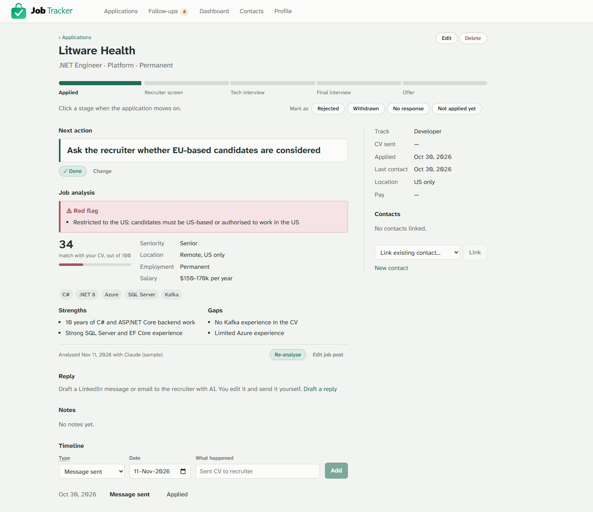
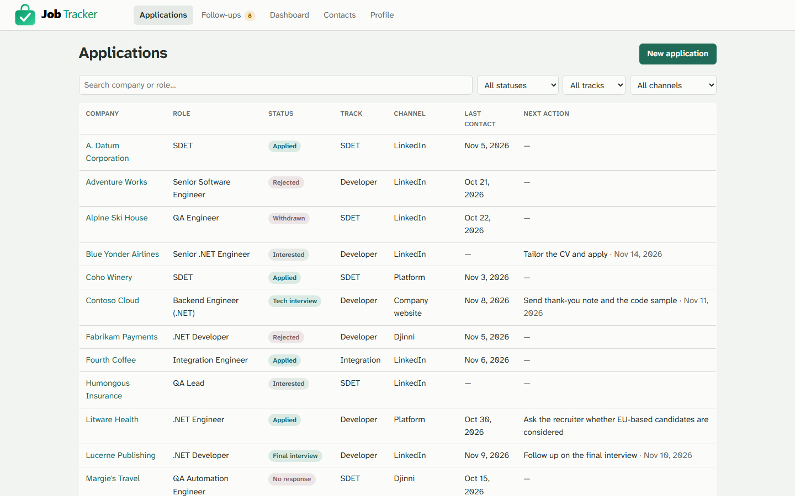
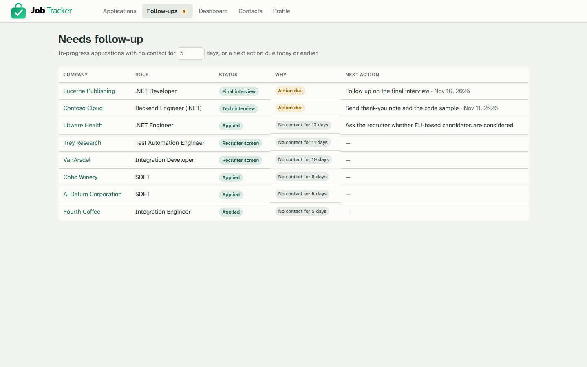
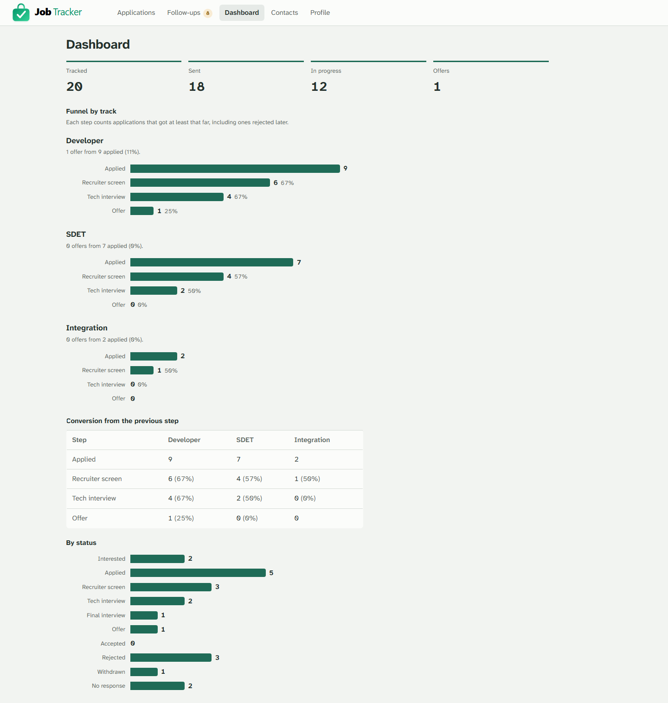
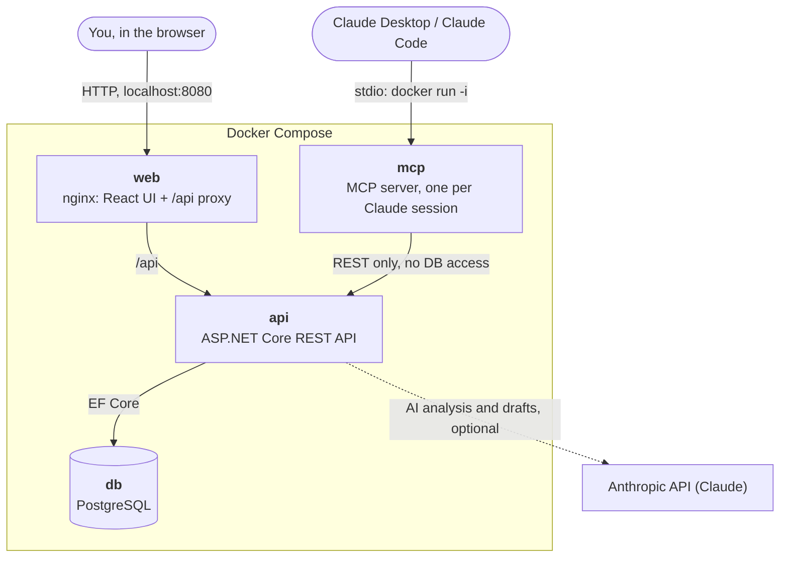
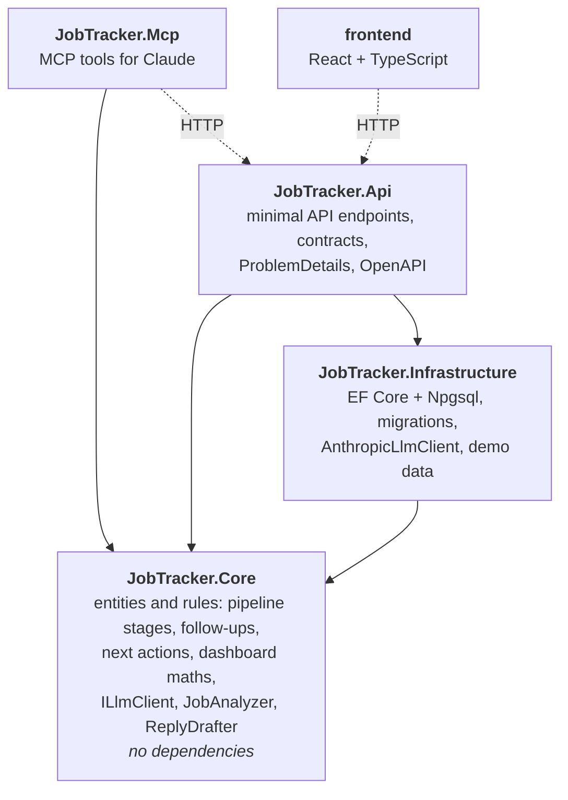

# Job Tracker

[](https://github.com/shrytsenko/job-tracker/actions/workflows/ci.yml)

A personal job-search tracker with AI assistance, built with **ASP.NET Core**, **React** and **TypeScript**.

Track applications, recruiters and referrals in one place, see which follow-ups are due, and compare how different job tracks are converting. An AI assistant analyses job descriptions, flags restrictions like "US work authorization required", scores how well a role matches your profile, and drafts replies to recruiters.

> 🚧 **Work in progress.** I'm building this in public while running my own job search. See the roadmap below for what's done and what's next.

## Screenshots

All data in these screenshots is fictional demo data.

**An application:** the hiring pipeline as a stage track, the next action, and an AI analysis of the job post that red-flags a "US only" restriction.



| Applications | Follow-ups |
| --- | --- |
|  |  |

**Dashboard:** a funnel per track (Developer vs SDET) on one scale, with conversion from each step to the next.



## Why I built it

During my own job hunt I ended up juggling LinkedIn messages, Djinni, recruiter emails, freelance platforms and referrals from former colleagues across several markets. Spreadsheets didn't answer the questions I actually had:

- Who haven't I replied to, and who hasn't replied to me?
- Is this role even open to someone based in Spain?
- Which track is working better for me: developer or test automation?

So I'm building the tool I needed, and using it as a showcase of how I approach software: a clean backend, tests at every level, CI from day one and practical AI integration.

## Features

- [x] Applications with status, track, channel, compensation and next action 
- [x] Contacts (recruiters, referrers, hiring managers) linked to applications 
- [x] Activity timeline per application 
- [x] "Needs follow-up" view for stale applications and overdue actions
- [x] Dashboard with a funnel and conversion rates per track
- [x] AI job description analysis: stack, seniority, location restrictions, match score, red flags
- [x] AI-drafted replies to recruiters (always editable, never sent automatically)
- [x] MCP server so AI assistants like Claude can read and update the tracker

## Tech stack

| Layer | Technology |
| --- | --- |
| Backend | C#, ASP.NET Core Web API, Entity Framework Core |
| Database | PostgreSQL (Docker) |
| Frontend | React, TypeScript, Vite |
| AI | LLM provider behind a swappable `ILlmClient` interface |
| Testing | xUnit, `WebApplicationFactory` integration tests, Playwright end-to-end tests |
| CI/CD | GitHub Actions |
| Packaging | Docker (multi-stage images, non-root), docker-compose, nginx |

## Roadmap

1. ✅ **Core tracker API** — domain model, CRUD endpoints, validation, tests
2. ✅ **React UI** — list, filters, detail page, follow-up view
3. ✅ **Dashboard** — funnel and conversion per track
4. ✅ **AI job analysis** — structured analysis of pasted job descriptions
5. ✅ **AI reply drafts** — recruiter messages and emails
6. ✅ **MCP server** — manage the tracker from Claude
7. ✅ **Portfolio polish** — CI badge, Docker, Playwright end-to-end tests, screenshots, architecture diagram

## Getting started

Requires the [.NET 10 SDK](https://dotnet.microsoft.com/download), [Node.js 24 LTS](https://nodejs.org/) and [Docker Desktop](https://www.docker.com/products/docker-desktop/).

### Run everything in Docker

The quickest way to use the app (only Docker needed):

```bash
cp .env.example .env              # one time: set POSTGRES_PASSWORD
docker compose up -d --build      # PostgreSQL + API + UI
```

Open **http://localhost:8080**. nginx serves the UI and forwards `/api` to the API container; the API is not published on its own, and both published ports are bound to `localhost` only. Stop with `docker compose down` (your data stays in the volume).

### Develop locally

For day-to-day development, run only the database in Docker and the API and UI on your machine (debugger, hot reload).

**One time** — pick a database password and give it to both Docker and the API:

```bash
cp .env.example .env      # then set POSTGRES_PASSWORD in .env
dotnet user-secrets set ConnectionStrings:JobTracker "Host=localhost;Port=5432;Database=jobtracker;Username=jobtracker;Password=<same password>" --project backend/src/JobTracker.Api
```

`.env` is git-ignored and user secrets live in your user profile, so the password never ends up in the repository.

**Every time** — start the database, then the API and the UI in two terminals:

```bash
docker compose up -d db                   # PostgreSQL on localhost:5432

# terminal 1: API on http://localhost:5122
cd backend
dotnet run --project src/JobTracker.Api

# terminal 2: UI on http://localhost:5173
cd frontend
npm install
npm run dev
```

Open **http://localhost:5173**. The Vite dev server forwards `/api` requests to the API, so the browser sees a single origin and the API needs no CORS configuration.

The API starts on `http://localhost:5122` and opens **Swagger UI** at `http://localhost:5122/swagger`, where you can try every endpoint. The raw OpenAPI document is at `/openapi/v1.json`. The database schema is created and migrated automatically on first start. Your data lives in the Docker volume `jobtracker-data`; it survives restarts and `docker compose down` (only `docker compose down -v` deletes it). To back it up: `docker compose exec db pg_dump -U jobtracker jobtracker > backup.sql`. [`JobTracker.Api.http`](backend/src/JobTracker.Api/JobTracker.Api.http) has ready-made requests for VS Code / Rider / Visual Studio.

### AI job analysis (optional)

Paste a job post on an application's page and click **Analyse job post** to get the stack it asks for, seniority, location and work-permit restrictions, employment type, salary, a 0–100 match score against your CV summary, strengths, gaps and **red flags**. Fill in your CV summary on the **Profile** page first.

It needs an [Anthropic API key](https://platform.claude.com). Locally, set it once (in your own terminal, so it doesn't end up in any log):

```bash
dotnet user-secrets set Anthropic:ApiKey "<your key>" --project backend/src/JobTracker.Api
```

In Docker, put it in `.env` as `ANTHROPIC_API_KEY=...`. Without a key the app works normally and analysis says it is not configured. Each analysis costs a few cents; the model and effort are settings (`Anthropic:Model`, default `claude-opus-5-5`; `Anthropic:Effort`, default `medium`).

### AI reply drafts

Under **Reply** on an application, pick the recipient (one of its linked contacts), LinkedIn or email, short or detailed, optionally paste their message and say what you want to get across, then **Draft reply**. The draft answers in the language of their message, uses only facts from your CV and the application, and leaves [placeholders] for anything it does not know (salary, start date). Edit it, **Copy** it, send it yourself, then **Log as sent** to add a "Message sent" entry to the timeline. The app never sends anything.

### Use the tracker from Claude (MCP)

`backend/src/JobTracker.Mcp` is an [MCP](https://modelcontextprotocol.io) server, so Claude Desktop or Claude Code can work with the tracker: *"add the Contoso .NET role as applied"*, *"who haven't I heard back from in 5 days?"*, *"log that Dana replied and remind me to follow up on Friday"*, *"analyse the job post on the Rf-SMART application"*.

| Tool | What it does |
| --- | --- |
| `list_applications`, `get_application` | Find applications (filters, search) and read one in full |
| `add_application`, `update_status` | Add an application, move it through the pipeline |
| `log_activity` | Add a timeline entry (messages and replies update the last contact date) |
| `get_followups` | Applications with no contact for N days or a next action due |
| `set_next_action`, `complete_next_action` | Plan the next step, mark it done |
| `get_job_post`, `save_job_analysis` | Let Claude analyse a job post with the app's own rules and save it (same validation and "US only" backstop as the built-in analysis, no API credits needed) |

It only talks to the REST API (it holds no database credentials), and there is deliberately no delete tool. It finds the API through `JobTrackerApi__BaseUrl`: `http://api:8080` in its Docker image, `http://localhost:8080` by default otherwise.

**Option A: run it in Docker (recommended).** Only Docker is needed. Build the image once (and after changes):

```bash
docker compose build mcp
```

Claude then starts a short-lived container per session on the stack's network, where it reaches the API at `http://api:8080`. The stack must be running (`docker compose up -d`); `docker compose up` itself never starts the MCP container.

Claude Code:

```bash
claude mcp add --transport stdio job-tracker -- docker run -i --rm --network job-tracker_default job-tracker-mcp
```

Claude Desktop (`claude_desktop_config.json`, then restart Claude Desktop):

```json
{
  "mcpServers": {
    "job-tracker": {
      "command": "docker",
      "args": ["run", "-i", "--rm", "--network", "job-tracker_default", "job-tracker-mcp"]
    }
  }
}
```

**Option B: run it as a local executable.** Useful when you run the API with `dotnet run`:

```bash
dotnet publish backend/src/JobTracker.Mcp -c Release -o publish/mcp
claude mcp add --transport stdio --env JobTrackerApi__BaseUrl=http://localhost:5122 job-tracker -- "D:/Programming/job-tracker/publish/mcp/JobTracker.Mcp.exe"
```

In Claude Desktop, use the executable's path as `command` and pass the same `JobTrackerApi__BaseUrl` under `env`. Adjust paths to your clone; use `http://localhost:8080` to reach the Docker stack instead.

### Demo data

To try the app with realistic numbers without touching your own data, start the API with the **demo** profile:

```bash
cd backend
dotnet run --project src/JobTracker.Api --launch-profile demo
```

It uses a separate `jobtracker_demo` database on the same PostgreSQL server and fills it with 20 fictional applications (companies from Microsoft's standard fictional names, `example.com` emails) the first time it starts. The same data backs the dashboard tests. To reset it: `docker compose exec db dropdb -U jobtracker jobtracker_demo`.

### Running the tests and checks

The same checks run in [GitHub Actions](.github/workflows/ci.yml) on every push to `main` and on every pull request: backend format check, analysis, build and tests; frontend lint, format check and build; a Docker image build; and the end-to-end tests against the app in Docker (with the Playwright report attached when they fail). [CodeQL](.github/workflows/codeql.yml) scans the C# and TypeScript code for security issues, and [Dependabot](.github/dependabot.yml) opens weekly pull requests for outdated packages, base images and actions.

```bash
cd backend && dotnet test                                # unit + integration tests (integration tests need Docker running)
cd backend && dotnet format JobTracker.slnx --verify-no-changes   # formatting and code style
cd frontend && npm run build                             # TypeScript type-check + production build
cd frontend && npm run lint                              # oxlint
cd frontend && npm run format:check                      # Prettier (npm run format to fix)
cd e2e && npm run typecheck && npm run format:check      # type-check and format the test code too
```

Code style is defined once in [`.editorconfig`](.editorconfig) (C#) and [`.prettierrc.json`](.prettierrc.json) (TypeScript). The backend builds with the recommended .NET analyzers and code-style rules enforced, and warnings are treated as errors, so a style or analyzer issue fails the build locally and in CI. Every public member of `JobTracker.Core` must have an XML doc comment; the other projects have comments where they add something.

**End-to-end tests** ([Playwright](https://playwright.dev), in `e2e/`) drive the real UI in Chromium against the whole app running in Docker. They cover the main flows: create an application through the form, change its status on the stage track, and see an overdue next action in Follow-ups.

```bash
cd e2e
npm install
npx playwright install chromium   # one time
npm run stack:up                  # isolated stack: project job-tracker-e2e, http://localhost:8081
npm test                          # or: npm run test:ui
npm run stack:down                # removes the e2e containers and their database
```

`npm run screenshots` (with the stack up) recreates the screenshots above in `docs/screenshots/`, from the e2e stack's fictional demo data.

They never touch your own data: the e2e stack has its own database volume and ports (web 8081, Postgres 5433), uses `e2e/.env.e2e` instead of your `.env`, and the test setup refuses to run against port 8080.

## API overview

| Method | Route | Purpose |
| --- | --- | --- |
| GET | `/api/applications?status=&track=&channel=&search=` | List applications, optional filters and company/role search |
| GET | `/api/applications/follow-ups?days=5` | Open applications with no contact for N days or a next action due |
| GET | `/api/applications/{id}` | Application with contacts and timeline |
| POST | `/api/applications` | Create |
| PUT | `/api/applications/{id}` | Update (including status) |
| DELETE | `/api/applications/{id}` | Delete (with its timeline) |
| POST | `/api/applications/{id}/activities` | Add a timeline entry |
| PUT | `/api/applications/{id}/next-action` | Set or clear the next action |
| POST | `/api/applications/{id}/next-action/complete` | Mark it done: logs "Done: …" on the timeline as the chosen activity type and clears it |
| PUT / DELETE | `/api/applications/{id}/contacts/{contactId}` | Link / unlink a contact |
| GET, POST | `/api/contacts` | List / create contacts |
| GET, PUT, DELETE | `/api/contacts/{id}` | Read / update / delete a contact |
| GET | `/api/applications/cv-versions` | Distinct CV version names used so far (for autocomplete) |
| POST | `/api/applications/{id}/analysis` | Analyse the pasted job post with AI against your CV summary (saves the post, replaces the previous analysis) |
| POST | `/api/applications/{id}/reply-draft` | Draft a LinkedIn message or email to a linked contact with AI (returns editable text; nothing is sent) |
| GET, PUT | `/api/profile` | Your name and CV summary, the context for analyses and drafts |
| GET | `/api/dashboard` | Counts per status and track, and a funnel per track with conversion rates |
| GET | `/api/companies` | Distinct company names from applications and contacts (for autocomplete) |

Enums travel as strings (`"Applied"`, `"SDET"`, `"EUR"`). Errors follow [RFC 9457 ProblemDetails](https://www.rfc-editor.org/rfc/rfc9457); validation errors list the offending fields under `errors`.

## Architecture

**How the running app fits together.** Everything runs in Docker Compose; only the web container (and PostgreSQL, for local development) is published, both on `localhost` only.



**How the code is layered.** `Core` holds the domain and the application rules and depends on nothing; the outer projects plug into it. The AI provider sits behind `ILlmClient`, so tests use a fake and the provider could be swapped without touching the rules.



**Where things live:**

```
backend/
  src/JobTracker.Core            Domain entities, enums and rules. No dependencies.
  src/JobTracker.Infrastructure  EF Core DbContext, PostgreSQL (Npgsql), migrations, demo data.
  src/JobTracker.Mcp             MCP server (stdio) for Claude: thin tools over the REST API, no database access.
  src/JobTracker.Api             Minimal API endpoints, request/response contracts, error handling, OpenAPI.
  tests/JobTracker.Core.Tests    Unit tests for domain rules (xUnit).
  tests/JobTracker.Api.Tests     Integration tests through HTTP with WebApplicationFactory and a real PostgreSQL (Testcontainers).
e2e/                             Playwright end-to-end tests (TypeScript) against the app running in Docker.
frontend/
  src/api                        Typed API client (the only place that calls fetch) and types mirroring the C# contracts.
  src/pages                      One component per route: applications list/detail/form, follow-ups, contacts.
  src/components                 Small shared pieces: layout, form fields, status badge, error banner.
```

Key decisions:

- **Minimal APIs with route groups** instead of controllers: less ceremony and the idiomatic style in modern .NET, while still grouped per resource.
- **Rules live on the entities.** For example, logging a real interaction moves `LastContactOn` forward, and moving to `Applied` stamps `AppliedOn`. The endpoints stay thin and the rules are unit-testable without a database.
- **Company is free text, with autocomplete.** A recruiter's company is often an agency rather than the hiring company, so the two fields stay independent; `/api/companies` just suggests existing names to keep spelling consistent. A `Company` entity can be introduced later with a simple `SELECT DISTINCT` migration if company pages are needed.
- **No repository layer.** `DbContext` already is a unit of work over repositories. Another abstraction would add code without adding value at this size.
- **Enums stored as text**, so the data is readable in any SQL client and reordering enum members can't corrupt data.
- **Next action has a lifecycle**: set → done (logged on the timeline) → set the next one. `SetNextAction` and `CompleteNextAction` on the entity enforce it, e.g. a due date needs a description. Completing as a message or reply also counts as contact.
- **The pipeline is the UI.** Each application shows a stage track (Applied to Offer), drawn like a CI pipeline; clicking a stage changes the status. `FurthestStage` is kept when an application closes, so a rejection shows where it stopped, and the Phase 3 funnel can count how far each application got.
- **Follow-up rule on the domain.** "No contact for N days" and "next action due" are `Application` methods with unit tests. The endpoint and, later, the MCP server reuse them instead of re-implementing the rule.
- **React with only React Router as a dependency.** Data fetching is a small `useAsync` hook over a typed client, and styling is one plain CSS file with variables (light and dark themes) and a self-hosted font (Atkinson Hyperlegible Next). Filters live in the URL, so reloads and the back button keep them.
- **Dashboard maths is a pure function.** `DashboardCalculator` in Core takes applications and returns the stats, so the funnel rules are unit-tested without a database. The funnel counts the *furthest stage reached*, so an application rejected after the tech interview still counts towards the earlier steps and conversion rates aren't inflated.
- **The AI sits behind `ILlmClient`.** Core owns the prompt, the JSON schema and the validation (`JobAnalyzer`); `AnthropicLlmClient` in Infrastructure is the only code that knows about Claude (official Anthropic SDK, structured output, server-side refusal fallback). Tests and CI use a fake client and never call the real API.
- **A deterministic backstop for restrictions.** `RestrictionScanner` always red-flags phrasings like "US only", "must be authorized to work in the United States", "W2" or "no visa sponsorship", even if the model misses them. The model handles nuance; the rule guarantees the one thing that must never slip through.
- **Integration tests run the real migrations** against a real PostgreSQL in a throwaway Docker container (Testcontainers): one container per test run, one database per test class. They test the same database engine and schema the app uses.

## Security

This is a single-user tool meant to run on your own machine. It has **no authentication**, so it binds to `localhost` only; add authentication and rate limiting before exposing it anywhere else. Within that scope:

- **SQL injection.** All database access goes through EF Core LINQ, which always sends parameterised queries; there is no raw SQL in the code.
- **Prompt injection.** Job posts and recruiter messages are untrusted text from the internet. The prompts put them in delimited sections (`<job_post>`) and tell the model to treat them as data, never as instructions. The model's answer must match a JSON schema and is validated before saving, and the "US only" style red flags come from a deterministic rule as well, so a post can't talk its way out of them. Drafts are only ever shown as editable text; nothing is sent automatically.
- **MCP server.** It calls the REST API only (no database credentials) and has no delete tool. Its server instructions, the descriptions of tools that return pasted text, and the `get_job_post` result all tell Claude to treat that text as data and to change data only when you asked.
- **Browser hardening.** nginx sends a strict Content-Security-Policy (`'self'` only, no inline scripts or styles, no framing) and `X-Content-Type-Options`, `X-Frame-Options`, `Referrer-Policy`, `Permissions-Policy` and `Cross-Origin-Opener-Policy` headers, and hides its version. An e2e test checks the headers and that every main page renders with no CSP violations.
- **Input limits.** Requests are validated (ProblemDetails on errors), notes are capped at 10,000 characters in the API, the database and the forms, and nginx limits request bodies to 1 MB.
- **Containers.** API, MCP and web images run as non-root users; only the web UI and PostgreSQL are published, both on `127.0.0.1`.
- **Secrets.** The database password and API key come from `.env`, environment variables or .NET user secrets, never from the repository; job posts and personal data are not logged.
- **Supply chain.** CodeQL scans every push and pull request, and Dependabot keeps NuGet, npm, Docker and GitHub Actions dependencies up to date.

## Privacy

The repository contains only fictional seed data. Real data stays in a local PostgreSQL volume that is never part of the repository, and the database password and API keys are read from environment variables or .NET user secrets.

## Author

**Serhii Hrytsenko** · Software Engineer · Barcelona, Spain

[LinkedIn](https://www.linkedin.com/in/shrytsenko) · [GitHub](https://github.com/shrytsenko)
